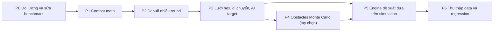

# ⚔️ Battle Engine — Báo cáo Audit & Lộ trình Phát triển

> **Phạm vi:** Engine đề xuất đội hình (`recommendLineupForWaves` / `recommend_v661`) và simulator (`simulateBattle` / `simulate_battle`) trong `index.html` + `tools/benchmark_dump.py`.
> **Dữ liệu kiểm định:** 40 trận `InstantBattleResultVO` lấy từ 4 file dump (31 trận Tourney 6★ + 9 trận live ngày 05–06/11/2026).
> **Công cụ đo:** `python tools/audit_engine_fidelity.py` — chạy lại sau mỗi phase để đo KPI.
> **Ngày audit:** 2026-11-07

---

## 0. Kết luận nhanh

| Câu hỏi | Trả lời |
| :--- | :--- |
| Simulator đã khớp dữ liệu thật chưa? | **Chưa.** Khi chạy simulator với **đúng đội hình người chơi đã đánh**: sai số tổn thất trung bình (MAE) **12.8 điểm %**, tương quan Pearson **0.71**, và **dự đoán THẮNG cho cả 2 trận thực tế THUA** (B22, B35). |
| Benchmark "Advisor tốt hơn người chơi" có đáng tin không? | **Không.** `benchmark_dump.py` so **kết quả giả lập** của Advisor với **kết quả thật** của người chơi — hai thứ khác loại. Simulator lạc quan hơn thực tế khoảng 4.4 điểm, nên phần lớn mức "cải thiện" 5.98 điểm chỉ là sai lệch của simulator. So công bằng (cả hai bên đều chạy qua simulator) thì Advisor chỉ hơn khoảng **1.6 điểm**, nhỏ hơn nhiều so với sai số 12.8 điểm → **chưa kết luận được gì**. Kết luận "Advisor cứu 2 trận thua" trước đây là **sai**. |
| Có nên thêm **Chướng ngại vật (Obstacles)**? | Chướng ngại vật **có thật** trong game, nhưng **chưa nên làm ngay**. Vị trí của chúng **không có trong packet**, thay đổi theo từng trận, và chỉ ảnh hưởng khoảng **2.6% số lượt di chuyển**. Để sau Phase 3, làm dạng ngẫu nhiên (Monte Carlo). |
| Có nên thêm **Debuff kéo dài nhiều round**? | **Nên, ưu tiên cao.** Có thật và ảnh hưởng lớn: **85%** đòn đánh có gắn debuff, **48%** đòn bị debuff đang hoạt động làm thay đổi `attackModifier`. Simulator hiện **bỏ qua hoàn toàn**. Lưu ý: Elvenar **không có sát thương theo thời gian (DoT)**. Các kỹ năng tên "Poison…" thực chất chỉ là debuff giảm công. |

---

## 1. Phát hiện then chốt: packet chứa nhật ký trận đầy đủ

`InstantBattleResultVO.state.stepHistory[]` (`BattleStepVO`) ghi lại **từng hành động** của server. Đây là dữ liệu chuẩn để kiểm định:

```text
unitId, path[(x,y)...], attackedUnitId, dealtDamage, attackModifier,
killedUnits, attackedUnitHitpoints, retaliationDamage, amountOfUnits,
attackedAmountOfUnits, targetNewBuffs{attack_negative|defense_negative: UnitBuffVO{value,duration,name}}
```

Ngoài ra còn có `unitsOrder[].startpos/pos` (lưới thật), `startHitpoints` (HP đã cộng buff thành phố), `activeBuffs`, `retaliations`, `teamInitiative`, `unitType.damageRange = 0.2`.

> [!IMPORTANT]
> Server **lược bỏ các trường có giá trị 0** (`x: 0`, `attackModifier: 0`, `duration: 0`). Mọi parser phải dùng `.get(key, 0)`.

---

## 2. Bảng kiểm định từng cơ chế (thực tế vs simulator hiện tại)

| # | Cơ chế | Thực tế (từ `stepHistory`) | Simulator hiện tại | Đánh giá |
| :-: | :--- | :--- | :--- | :-: |
| 1 | Mapping slot → y | Thứ tự `army[]` trong encounter khớp `SLOT_Y=[4,3,5,2,6]` | Như vậy | ✅ Đúng |
| 2 | Thứ tự lượt | Initiative giảm dần, 0/360 vi phạm. Khi hòa thì phe ta thường đi trước (có ngoại lệ do `teamInitiative`) | Như vậy | ✅ Đúng |
| 3 | Buff thành phố | HP: `startHitpoints/hitpoints` ≈ 1.775. Tỉ lệ sát thương phe ta ≈ 1.6–2.1 khớp LR+104%, MA+90%, HM+83%, LM+73%, HR+60% | Như vậy | ✅ Đúng |
| 4 | Lưới bàn cờ | **Lưới lục giác 8×9 kiểu odd-r** (2361/2361 bước đi là ô kề nhau). Phe ta xuất phát ở `x=0`, địch ở `x=7`, `y=2..6` | **Không có lưới**, chỉ dùng `dy` và luật "R1: reach<6 thì bỏ lượt" | ❌ Sai lớn |
| 5 | Di chuyển / tầm bắn | Số bước ≤ `movementPoints` (0 vi phạm), khoảng cách tấn công ≤ `range` (0 vi phạm). Lính đứng chặn đường | Không mô phỏng | ❌ |
| 6 | Công thức modifier | `(1 + atk − def) × (1 + buffCông) × (1 − debuffThủ) − 1`. Ví dụ: Drone→Wild Archer bị Silver Scream: 1.9×1.5 = **+185** | `(1+atk)(1−def)`, không có buff | ⚠️ Cùng kết quả khi không có buff (trong data không có cặp nào có cả atk lẫn def), nhưng sai khi có debuff |
| 7 | Dao động sát thương | `damageRange=0.2`. Hệ số thực có p25≈0.98, p50≈1.07, p75≈1.22 | Tất định ×1.0 | ⚠️ Thiếu khoảng +7% sát thương trung bình và không có phương sai |
| 8 | Số lính chết | Tính trên tổng HP pool, có cộng HP lẻ của lính đầu hàng: khớp ±1 ở 901/953 đòn (94.5%) | `floor(dmg/hp)`, bỏ qua HP lẻ | ⚠️ Nhỏ |
| 9 | Phản đòn | Xảy ra khi **mục tiêu ở trong tầm của chính nó** + còn lượt phản đòn + còn sống. Lính tầm xa vẫn bị phản đòn (ví dụ Orc Strategist tầm 3 đánh Bandit tầm 4). 178 lần phản đòn | Chỉ áp dụng khi kẻ tấn công có `rng==1` | ❌ |
| 10 | Kỹ năng / debuff | Lính tier 3 của ta kích hoạt kỹ năng **100%** mỗi đòn trúng. Quái tier 1 không có kỹ năng. Thời lượng 1–3. Mỗi loại (`attack_negative`, `defense_negative`) chỉ giữ 1 slot | **Không mô phỏng** | ❌ Sai lớn |
| 11 | AI chọn mục tiêu | Địch: 78.8% chọn mục tiêu có modifier cao nhất trong số đánh tới được, 67.8% chọn mục tiêu gần nhất. Phe ta (auto): khoảng 67% | Hàm điểm tự chế (`+100·atkB`, `−12·dy`, ưu tiên mục tiêu máu yếu, phạt hàng sau) | ⚠️ Chưa được fit với dữ liệu |
| 12 | Chướng ngại vật | 28/1080 lượt đi vòng không giải thích được bằng lính chặn. 26/28 trường hợp né một ô **không ai từng bước vào** trong trận đó. Client có 27 loại asset `battle.obstacles.*` chiếm 1–4 ô | Không có | ℹ️ Có thật, ảnh hưởng nhỏ |
| 13 | Độ dài trận | Thực tế 1–8 round (trung bình 3.33) | Trung bình 3.30 | ✅ Khớp trung bình |

### Bảng KPI baseline (đầu ra mục 7 của `audit_engine_fidelity.py`)

| KPI | Baseline | Mục tiêu cuối |
| :--- | :-: | :-: |
| Khớp kết quả Thắng/Thua | 38/40 | 40/40 |
| Trận thua thật được cảnh báo rủi ro | **0/2** | 2/2 |
| MAE % tổn thất | **12.8** | ≤ 6.0 |
| Pearson r | 0.706 | ≥ 0.90 |
| Số trận sai > 20 điểm | 6 | 0 |

---

## 3. Đánh giá engine đề xuất (scoring)

1. **Quá khớp (overfitting):** Rule A/A1/A2/B/B1/C/D cùng hàng chục hằng số (`65.0`, `35.0`, `−150`, …) được chỉnh trên **chính 31–35 trận** dùng để benchmark. Không có tập kiểm tra riêng (holdout).
2. **Chọn tham lam độc lập từng slot:** Mỗi slot lấy candidate có điểm cao nhất mà không đánh giá **cả đội hình** (lượt đi, lính chặn đường, ai giữ ai).
3. **Chỉ là proxy:** Điểm số không được kiểm định bằng simulator đáng tin, nên không biết điểm cao có đồng nghĩa ít tổn thất hay không.
4. **Kinh nghiệm thực chiến vẫn có giá trị:** Orc Strategist (16% tổn thất, 60 lượt chọn) và Elite Archer (97% tổn thất) là tín hiệu thật. Nguyên nhân giờ đã giải thích được bằng cơ chế: Head Hitter −30% công được kích hoạt 167/167 lần + thủ −80% trước LR. Nên **giữ làm prior**, không xóa ngay.

---

## 4. Lộ trình phát triển



> [!IMPORTANT]
> **Quy tắc chung cho mọi phase:**
> - Sửa simulator ở **cả** `index.html` (JS) **và** `tools/benchmark_dump.py` (Python). Có thể chuyển dần sang module JS dùng chung (xem P0.4).
> - Nếu chạm vào `elvenar-radar.user.js` thì đồng bộ sang file `…-5.2.user.js`, tăng `@version`, rồi commit + push + purge jsDelivr theo rule dự án.
> - Mỗi phase chỉ được merge khi KPI ở mục 7 **không xấu đi** so với phase trước.

### P0 — Nền tảng đo lường (ưu tiên ngay, công sức thấp)

| Task | Nội dung | File |
| :-- | :-- | :-- |
| P0.1 ✅ | Tool audit fidelity dựa trên `stepHistory` | `tools/audit_engine_fidelity.py` |
| P0.2 | **Sửa phương pháp benchmark:** so `sim(Advisor)` với `sim(đội hình thật)`, kèm cột `real`. Bỏ con số "Reduced by X%" khi so sim với thực tế | `tools/benchmark_dump.py` → `run_benchmark` |
| P0.3 | Unit test theo từng bước: replay `stepHistory`, dùng đúng attacker/target/count/buff của server để dự đoán `dealtDamage`, `killedUnits`, `retaliationDamage`. Báo tỉ lệ khớp | `tools/test_step_replay.py` (mới) |
| P0.4 | Golden fixtures: xuất 10 trận thành `tools/fixtures/*.json`. Python và JS (chạy bằng `node`) phải ra cùng kết quả → chống lệch logic giữa 2 bản | `tools/fixtures/`, `tools/sim_parity.mjs` |
| P0.5 | Chia tập train/holdout (ví dụ 30/10) để mọi tinh chỉnh hằng số chỉ được đo trên holdout | `audit_engine_fidelity.py --holdout` |

**Hoàn thành khi:** benchmark in ra 3 cột `real | sim(actual) | sim(advisor)` và step-replay chạy được.

### P1 — Sửa combat math (công sức thấp, tác động trung bình)

| Task | Nội dung chi tiết | Tiêu chí |
| :-- | :-- | :-- |
| P1.1 | Modifier cộng gộp: `mod = 1 + atk − def`, sau đó nhân buff | Step-replay: `attackModifier` khớp 100% ở các đòn không có buff |
| P1.2 | Thêm hệ số ngẫu nhiên: chế độ `expected` (×E[rand] fit từ data, khoảng 1.07–1.10) và chế độ `sample` (cho Monte Carlo) | Trung vị của `dealt/pred` ≈ 1.00 |
| P1.3 | Kill model dùng HP pool + HP lẻ của lính đầu hàng (`topHp`) | `killedUnits` khớp ±1 ≥ 95% |
| P1.4 | Phản đòn theo tầm: xảy ra nếu `hexdist(att, tgt) ≤ tgt.range` và `ret_left > 0` và mục tiêu còn sống. Fit công thức `retaliationDamage` từ 178 mẫu (xác minh: sát thương phản đòn tính theo số lính **sau** khi bị đánh) | ≥ 90% sự kiện phản đòn khớp có/không |
| P1.5 | Đọc `teamInitiative` để xử lý ngoại lệ khi hòa initiative | 0 vi phạm thứ tự |

> [!NOTE]
> P1.4 cần lưới (P3) mới tính được `hexdist` chính xác. Trước P3 có thể tạm dùng: "phản đòn nếu `tgt.range ≥ att.range`".

### P2 — Debuff nhiều round (công sức trung bình, tác động **cao**)

**Cơ chế đã xác minh từ data:**
- Kỹ năng đến từ `unitType.abilities` / DB `ab[]`. Lính của ta (tier 3) kích hoạt 100% mỗi đòn trúng. Quái tier 1 không có kỹ năng. Tier 2–3 cần xác minh thêm.
- Có 2 slot buff trên mỗi unit: `attack_negative` và `defense_negative`. Debuff mới **ghi đè** debuff cũ cùng loại.
- Hiệu lực: `attack_negative.value` nhân vào sát thương **do unit đó gây ra**. `defense_negative.value` làm tăng sát thương **unit đó phải nhận**: `×(1 − value/100)`, ví dụ Silver Scream −50 → ×1.5.
- `duration` 1–3. Việc trường này **bị lược bỏ** (=0) cho thấy buff hết hạn.

| Task | Nội dung | Tiêu chí |
| :-- | :-- | :-- |
| P2.1 | Xác định **thời điểm trừ duration** (đầu/cuối lượt của unit bị dính debuff hay cuối round) bằng cách so `duration` trong `targetNewBuffs` với `activeBuffs` cuối trận và `attackModifier` của các đòn sau | Có kết luận + test |
| P2.2 | Thêm `buffs: {attack_negative, defense_negative}` cho mỗi unit trong simulator. Áp vào công thức P1.1. Trừ duration theo P2.1 | Step-replay: `attackModifier` khớp ≥ 95% trên **mọi** đòn |
| P2.3 | Kiểm tra cơ chế **phản đòn có bị debuff công ảnh hưởng** không | Có test |
| P2.4 | Đồng bộ DB `ab[]` với `BattleUnitTypeVO.abilities` / `AbilityVO` trong dump (43 `AbilityVO`), kể cả quái tier 2/3 | DB khớp 100% |
| P2.5 | Bỏ heuristic `ability_bonus` trong `score_unit_pair` sau khi P5 hoàn thành (để simulator tự lượng hóa) | — |

> [!WARNING]
> **Không** thêm sát thương theo thời gian (DoT). Data không có bất kỳ dấu vết nào của sát thương theo round. Toàn bộ hiệu ứng "Poison Dart / Poison Sting" chỉ là `attack_negative`.

### P3 — Lưới hex, di chuyển & AI chọn mục tiêu (công sức cao, tác động **cao nhất**)

**Hình học đã xác minh:** lưới 8×9 kiểu odd-r (hàng `y` lẻ lệch phải). Láng giềng:
- `y` chẵn: `(±1,0) (0,±1) (−1,−1) (−1,+1)`
- `y` lẻ: `(±1,0) (0,±1) (+1,−1) (+1,+1)`

Spawn: phe ta `(0, SLOT_Y[i])`, địch `(7, SLOT_Y[i])`.

| Task | Nội dung | Tiêu chí |
| :-- | :-- | :-- |
| P3.1 | Module `hexgrid` (`to_cube`, `hexdist`, `neighbors`, BFS có ô bị chặn) dùng chung cho JS và Python | Unit test với 2361 bước đi thật |
| P3.2 | Vòng lượt: nếu đã có mục tiêu trong tầm thì đánh tại chỗ. Nếu chưa thì đi tối đa `mv` bước theo đường ngắn nhất (lính khác chặn đường) tới vị trí bắn được mục tiêu đã chọn. Nếu vẫn chưa tới tầm thì chỉ di chuyển | Vị trí cuối lượt khớp ≥ 80% số bước (replay) |
| P3.3 | **Fit AI chọn mục tiêu** từ data: thử các rule (modifier cao nhất trong reachable → gần nhất → sát thương kỳ vọng → HP pool…) rồi chọn rule khớp cao nhất. Áp riêng cho địch và cho phe ta (auto-battle cũng dùng AI) | Khớp đúng mục tiêu ≥ 85% (baseline 60.7% / 54.8%) |
| P3.4 | Thay luật "R1 reach<6 thì bỏ lượt" và `backline_penalty` bằng hình học thật | — |
| P3.5 | Bật lại phản đòn theo `hexdist` (hoàn tất P1.4) | — |

**Hoàn thành khi:** KPI mục 7 đạt MAE ≤ 8 và Pearson ≥ 0.85.

### P4 — Chướng ngại vật (tùy chọn, làm sau P3)

**Có đúng thực tế không?** Có.
- Client chứa 27 asset `battle.obstacles.*` (Stone 1 ô, Leafs 2–4 ô, Wall/Archway 4 ô…).
- 26/28 lượt đi vòng không giải thích được đều né những ô **không ai bước vào suốt trận**. Một số ô lặp lại giữa các trận, ví dụ `(6,6)`, `(6,2)`, `(1,3)`, `(2,2)` → có thể có template bản đồ.

**Vì sao chưa ưu tiên?**
1. `BattlefieldService.instantBattle` **không trả về** layout chướng ngại vật. Encounter trước trận cũng không có → **lúc đề xuất không biết bản đồ**.
2. Ảnh hưởng nhỏ: 28/1080 lượt đi (≈2.6%). Ảnh hưởng chính rơi vào lính cận chiến (Drone Rider, Cerberus, Hellhound) ở round 1–2.

| Task | Nội dung |
| :-- | :-- |
| P4.1 | Thử bắt packet **trận đánh tay** (`BattlefieldService.startByBattleType` hoặc tương tự) xem server có gửi layout không. Nếu có: hook trong `elvenar-radar.user.js` để lưu lại và xây thư viện layout thật |
| P4.2 | Nếu không có: suy luận ô bị chặn theo từng trận (ô chưa ai bước vào + gây đi vòng), gom thành phân bố thực nghiệm (tần suất mỗi ô / template) |
| P4.3 | Simulator Monte Carlo: lấy K layout (ví dụ K=30), trả về `E[loss]`, `P(defeat)`, p90 loss |
| P4.4 | Chỉ giữ tính năng nếu MAE trên holdout giảm ≥ 1 điểm. Nếu không thì tắt mặc định (chi phí tính toán ×K) |

### P5 — Engine đề xuất dựa trên simulation (sau P3)

| Task | Nội dung |
| :-- | :-- |
| P5.1 | **Sinh ứng viên:** dùng điểm heuristic hiện tại để lấy top-k (3–4) unit mỗi slot → 3⁵–4⁵ = 243–1024 đội hình. Lọc theo tồn kho (`state.arm.units`) |
| P5.2 | **Đánh giá:** chạy simulator (P1–P3, có P4 nếu bật) cho từng đội hình. Mục tiêu: `min E[loss] + λ·P(defeat)` (đề xuất λ ≈ 100) |
| P5.3 | **Spire nhiều wave:** mô phỏng tuần tự, mang quân còn sống sang wave sau (xác minh bằng `completedWave/totalWaves` + dump Spire), thay cho trọng số 0.45/0.35/0.20 |
| P5.4 | Hiệu năng trên trình duyệt: chạy Web Worker, cắt tỉa sớm (bỏ đội hình có loss > best + 15 sau 1 lượt tính expected), cache theo hash wave |
| P5.5 | UI: hiển thị `E[loss] ± p90`, `P(defeat)`, và 2–3 phương án thay thế. Cảnh báo đỏ khi `P(defeat) > 10%` |
| P5.6 | Gỡ dần các Rule A–D: chỉ giữ rule nào giúp holdout tốt hơn (ablation test) |

### P6 — Dữ liệu & regression liên tục

| Task | Nội dung |
| :-- | :-- |
| P6.1 | Mở rộng dataset lên ≥ 150 trận: Tourney nhiều mức sao, Spire (2–3 wave), World Map, cả trận thua |
| P6.2 | Lệnh regression: `python tools/audit_engine_fidelity.py --holdout` + `benchmark_dump.py` in ra bảng KPI và so với baseline đã lưu (`tools/baseline_kpi.json`) |
| P6.3 | Ghi changelog KPI theo từng version của advisor ở cuối file này |

---

## 5. Thứ tự triển khai đề xuất

| Bước | Phase | Công sức ước tính | Tác động kỳ vọng lên MAE |
| :-: | :-- | :-: | :-- |
| 1 | P0.2 – P0.3 | 0.5–1 ngày | — (đo lường đúng) |
| 2 | P1 | 1 ngày | −1 → −2 điểm |
| 3 | P2 | 1–2 ngày | −2 → −4 điểm (đặc biệt với đội hình nhiều Orc Strat / Drone) |
| 4 | P3 | 3–5 ngày | −3 → −5 điểm, sửa được dự đoán của 2 trận thua |
| 5 | P5 | 3–4 ngày | Đề xuất có cơ sở định lượng |
| 6 | P4 | 2–3 ngày (tùy chọn) | ≤ −1 điểm |

---

## 6. Changelog KPI

| Ngày | Phiên bản | Outcome | Defeats flagged | MAE | Pearson | Ghi chú |
| :-- | :-- | :-: | :-: | :-: | :-: | :-- |
| 2026-11-07 | v6.6.1 (baseline) | 38/40 | 0/2 | 12.8 | 0.706 | Audit đầu tiên, 40 trận |
